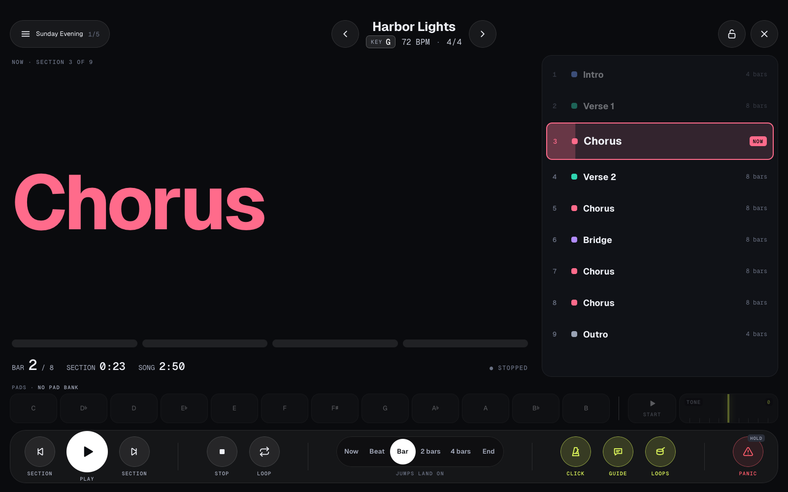
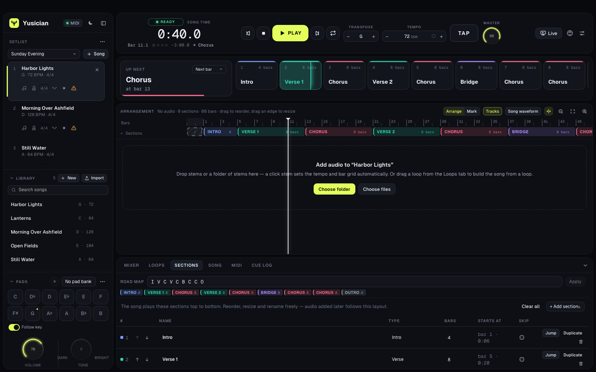
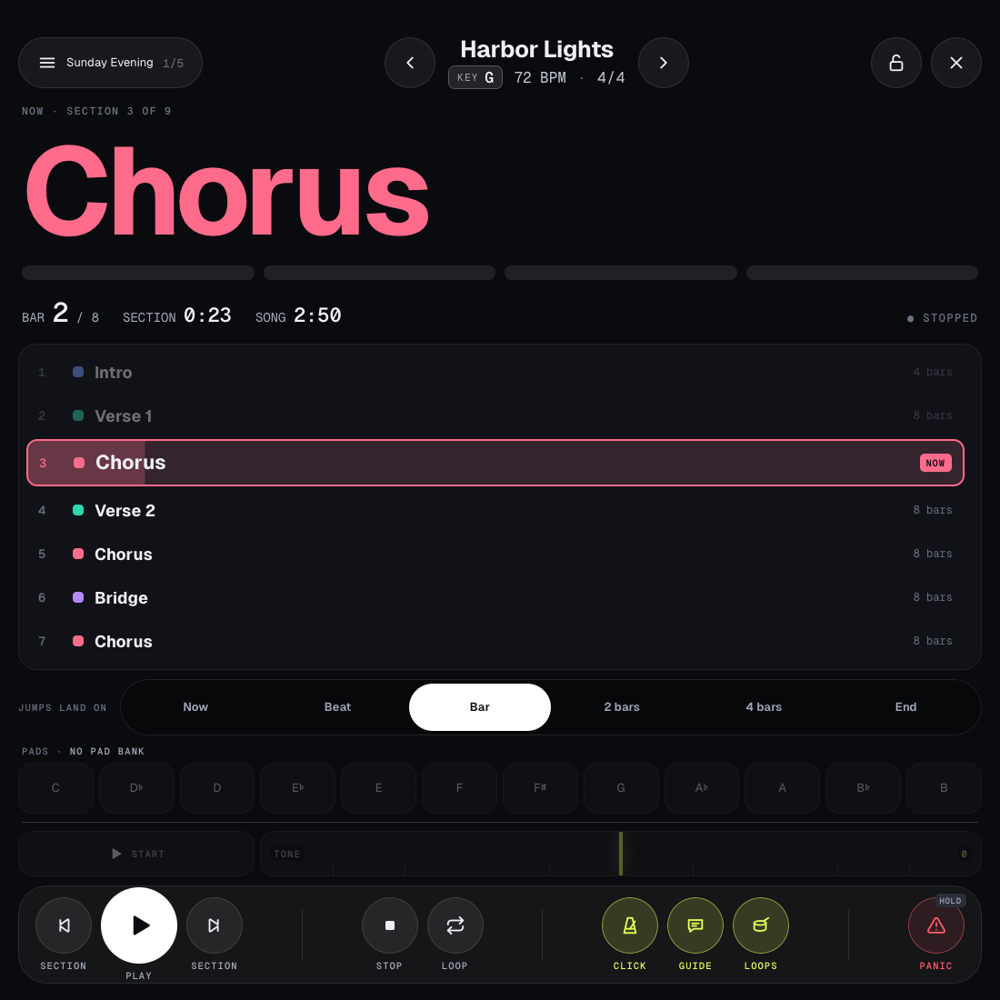
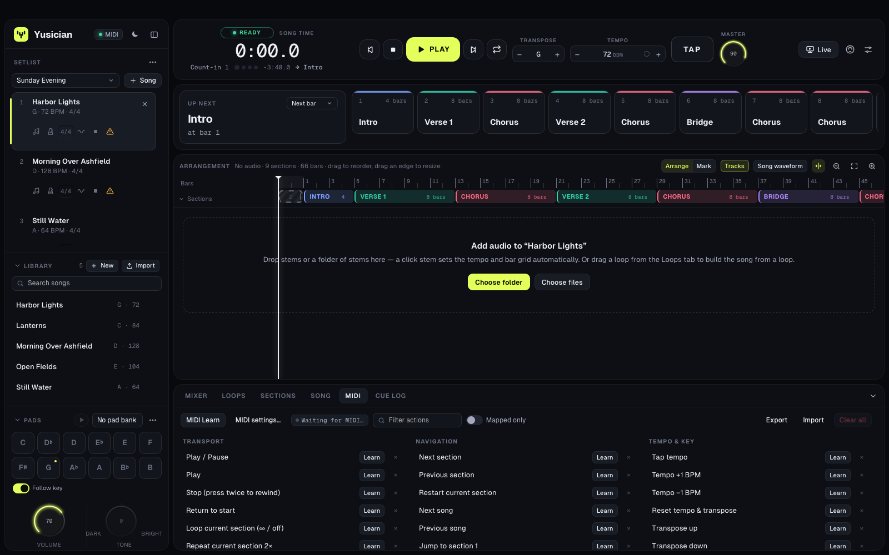
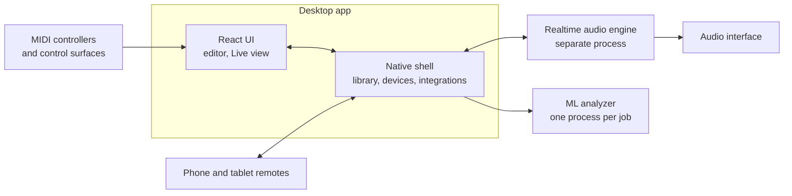

# Yusician

**A multitrack playback app for live worship sets.** Yusician plays a song's stems, click and spoken guide in time, sends each to its own output, and gives the band a calm stage screen they can trust in the middle of a service.

This repository is a project showcase. The application source is private.

  

## The problem

Many bands play to backing tracks. On stage, that means one person has to run stems, a click and spoken cues into in-ear monitors while also playing an instrument. The music can't stop if a screen stutters, a cable comes loose or someone brushes the wrong button, and the plan often changes mid-song: another chorus, a repeated bridge, a jump to the ending.

Yusician is built around that moment. Audio timing is kept apart from everything on screen, and every change made during a song lands musically, on the beat.

## What it does

| Area | What it offers |
| --- | --- |
| **Playback** | Multitrack stems with routing to any output of an audio interface, so the click and guide go to the in-ears and the band goes to front of house. |
| **Sections** | Songs are made of sections that can be reordered, looped, skipped or jumped to live. Jumps wait for the next beat, bar or section end. |
| **Spoken guide** | Section calls and count-ins generated by the app, timed to the song, including for jumps that have only just been queued. |
| **Tempo and key** | Real-time time-stretching and transposition, set per song or per setlist entry without changing the song itself. |
| **Pads and loops** | Twelve seamless ambient pads that crossfade between keys, and drum loops locked to the song's tempo. |
| **Live view** | A touch-friendly stage screen for landscape or portrait, with hold-to-confirm on risky actions and a screen lock. |
| **Control** | MIDI learn, automatic setup for Mackie Control and HUI surfaces, and phone or tablet remotes. |
| **Analysis** | On-device machine learning finds tempo, key and bar 1, splits a full mix into stems, and proposes where sections begin. |
| **Planning** | Imports service plans from Planning Center as ready-to-play setlists. |

## Screens

<table>
  <tr>
    <td colspan="2"> <b>The editor.</b> Setlist, library, pads, and a song's arrangement. Typing a one-line road map builds the sections.</td>
  </tr>
  <tr>
    <td width="50%"> <b>Live, in a narrower window.</b> The stage screen rearranges itself for a tablet or an upright display.</td>
    <td width="50%"> <b>MIDI.</b> Nearly every action can be mapped to hardware by pressing a control.</td>
  </tr>
</table>

## Architecture

| Layer | Technology |
| --- | --- |
| Interface | React, TypeScript, Zustand, Vite |
| Desktop shell | Tauri 2 and Rust, migrating from an earlier Electron release that shares the same UI and engine |
| Audio engine | Rust on the CoreAudio realtime thread |
| Machine learning | Open models for beat tracking and source separation, run in Rust on the CPU |
| Integrations | MIDI, the Planning Center API, the macOS Keychain |

### Engineering decisions

- **The audio has its own process.** The engine runs apart from the UI, so a busy screen can't cause a late click. If the engine ever crashes, it restarts and picks the song, pad and loop back up where they were.
- **Timing is decided on the audio thread.** Jumps, loops and clicks are scheduled against the audio clock, so they land exactly on the beat whatever the interface is doing.
- **Built for things going wrong on stage.** An unplugged interface pauses the song and reconnects by itself. Risky actions need a hold while playing, undo is off during playback, and a built-in timing report records dropouts and device events.
- **Machine learning stays on the machine.** Analysis needs no cloud service. Jobs run one at a time at low priority and can be cancelled, so they stay out of the way of playback.
- **A song and its performance are separate.** A setlist entry can have its own tempo, key and section order, while the song in the library stays as it was.
- **Results are suggestions.** Sections the app finds are marked for review, with a clear way to keep or discard them.
- **Everything is undoable.** Library edits go through one history system, and a drag or a multi-part operation counts as a single step.
- **Credentials stay in the native layer.** Tokens live in the macOS Keychain and are never handed back to the web layer.

## By the numbers

*As of November 2026.*

| | |
| --- | --- |
| Commits | 276 |
| TypeScript application code | ~23,500 lines |
| Rust (audio engine, analyzer, native shell) | ~11,300 lines |

## About this repository

Designed and built as a solo project, covering product, UX, realtime audio, machine learning integration and delivery. The source code, signal processing and analysis methods are private, so this repository contains only this overview and sample screenshots. All songs and setlists shown are fictional, and no audio is loaded in the screenshots.
